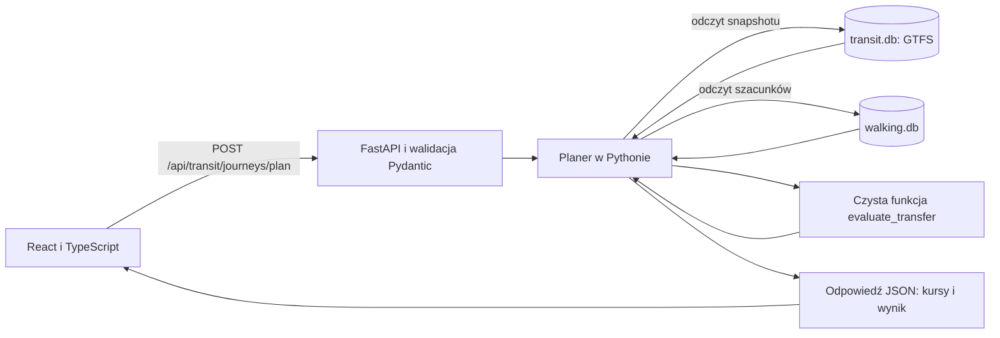
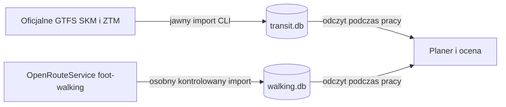

# Grafiki i audyt techniczny

## Zasady obrazu

Plansze podpisz „Architektura aplikacji” lub „Zasada rankingu”. Są objaśnieniem kodu. Ujęcia interfejsu pochodzą z działającej aplikacji. Nie twórz atrap kart z wynikami ani mapy z wymyśloną drogą dojścia.

Paleta aplikacji: tło #08080A, tekst #F3F2ED, opis #B0AFB8, linie #34343C; statusy #ABE58A, #FF5A5F i #8A8F99. Bahnschrift z fallbackiem Segoe UI. Jedna decyzja techniczna na planszy, bez neonów pod drobnym kodem. Dopuszczalne jest spokojne pojawienie się kolejnego elementu schematu. Sprawdź glify w renderze, szczególnie strzałkę i minus; w razie braków użyj fallbacku z odpowiednim znakiem lub zwykłego minusa.

## G1: własne wyszukiwanie i droga żądania, 1:35 do 1:56



Najpierw wyróżnij planer i konkretny przebieg: Wrzeszcz 17:02, Gdańsk Główny 17:09, dojście do Dworzec Główny 08, autobus 112 o 17:16 i Przegalina 02 o 18:21. Pociąg ma ten sam trip_id na obu stacjach, a cel musi być późniejszym postojem tego samego kursu autobusu. To schemat kolejności rzeczywistych rekordów, nie mapa trasy. Potem odsłoń podział UI/API, obie bazy i czystą funkcję. Osobny podpis dla suwaka: `POST /api/transit/transfers/search`, te same kursy, inne opóźnienie. Suwak nie wykonuje pełnego planowania ponownie. Vite przygotowuje frontend; nie jest elementem backendowego algorytmu. CSS Modules odpowiadają za style.

## G2: podział odpowiedzialności i czas, 1:56 do 2:11

Pokaż rzeczywisty fragment `evaluate_transfer`, od konwersji do UTC do różnicy czasu. Kadruj kod bez prywatnej ścieżki edytora. Obok zależność:

```text
zapas = odjazd ZTM - (przyjazd SKM + dojście + opóźnienie)
17:16 - (17:09 + 2 min + 0 min) = +5 min
```

Podpis „Pełne daty i offsety; porównanie chwil w UTC”. Liczby dotyczą 13.11.2026 i offsetu +01:00. Nie pokazuj samych godzin jako formatu rzeczywistych obliczeń.

## G3: odpowiedź pasująca do wyboru, 2:11 do 2:20

Dwie umowne linie żądań: „wybór A” i „wybór B”. Po zmianie wyboru pokaż anulowanie A, następnie sprawdzenie klucza i tożsamości odpowiedzi. Kod stosuje też flagę `disposed` i porównanie pochodzenia feedów. Nie dopisuj wymyślonych opóźnień sieci. Ostatnie sekundy przeznacz na prawdziwy animowany SVG. To schemat działania kodu, nie film z syntetycznym wynikiem podróży.

## G4: przygotowanie i odczyt danych, 2:20 do 2:35



Rozdziel nagłówkami „Przygotowanie danych” i „Praca aplikacji”. Symbol sieci występuje wyłącznie przy wcześniejszym imporcie. Podczas nagrywania niczego nie pobieraj. Cache A do B nie oznacza cache B do A. Zachowaj źródło i słowo „szacunkowe”.

## G5: konserwatywne dojście i ranking, 2:35 do 3:05

Przez pierwsze dziesięć sekund: `82,2 s / 60 = 1,37 min`, następnie `ceil = 2 min`. To zapis ORS dla `skm:7500` do `ztm:1021`. Podpis „Zaokrąglenie w górę; oryginalne sekundy pozostają w bazie”. Nie jest to pomiar z konkretnego peronu. Klient ORS nie zapisuje geometrii, więc nie rysuj sugerowanej ścieżki.

Potem wróć do „Dlaczego ta podróż?” przy +0 min. Wyróżnij kolejność rankingu: zapas co najmniej 2 min, potem wcześniejsze dotarcie do celu, krótsza podróż i oczekiwanie. Pełną kolejność zamykają stabilne identyfikatory. Nie dodawaj wag punktowych ani predykcji. Podpis „Najlepszy wynik w obsługiwanym zakresie”.

## Potwierdzone tezy i źródła

Audyt: 15.11.2026, `feature/gtfs-integration`, HEAD `99b4bfb` z istniejącymi zmianami lokalnymi. Odnośniki wskazują linie plików roboczych; nowe pliki nie muszą jeszcze istnieć na GitHub.

| Teza | Dowód w kodzie |
|---|---|
| Python 3.13; FastAPI, Uvicorn i tzdata | [backend/pyproject.toml:5](../../backend/pyproject.toml#L5) |
| Pydantic waliduje dane planera i odrzuca dodatkowe pola | [backend/app/gtfs/planner.py:25](../../backend/app/gtfs/planner.py#L25) |
| React, TypeScript i Vite; testy wbudowanego runnera Node.js | [frontend/package.json:6](../../frontend/package.json#L6) |
| CSS Modules, lokalny stan React i efekty komunikujące się z API | [frontend/src/Transit.tsx:47](../../frontend/src/Transit.tsx#L47) |
| Czysta funkcja ocenia przesiadkę przez porównanie chwil w UTC | [backend/app/transfer_logic.py:17](../../backend/app/transfer_logic.py#L17) |
| Jedna odczytowa transakcja GTFS i dalsze postoje konkretnych kursów | [backend/app/gtfs/planner.py:116](../../backend/app/gtfs/planner.py#L116) |
| Ranking: ≥2 min, dotarcie do celu, czas podróży, oczekiwanie, stabilne ID | [backend/app/gtfs/planner.py:108](../../backend/app/gtfs/planner.py#L108) |
| Cztery jawne kierunkowe powiązania od skm:7500 | [backend/app/gtfs/transfer_search.py:42](../../backend/app/gtfs/transfer_search.py#L42) |
| GTFS SQLite: sources, agencies, stops, services, exceptions, routes, trips, stop_times | [backend/app/gtfs/store.py:14](../../backend/app/gtfs/store.py#L14) |
| Import GTFS zastępuje jednego operatora w transakcji; błąd cofa import | [backend/app/gtfs/importer.py:50](../../backend/app/gtfs/importer.py#L50) |
| Walidacja ZIP i limitów rozmiaru | [backend/app/gtfs/archive.py:48](../../backend/app/gtfs/archive.py#L48) |
| CSV UTF-8 także z BOM | [backend/app/gtfs/archive.py:126](../../backend/app/gtfs/archive.py#L126) |
| Godziny >24 zachowane jako sekundy dnia kursowania | [backend/app/gtfs/schedule.py:21](../../backend/app/gtfs/schedule.py#L21) |
| GTFS: południe lokalne dnia kursowania minus 12 godzin upływu | [backend/app/gtfs/schedule.py:33](../../backend/app/gtfs/schedule.py#L33) |
| Europe/Warsaw, powtórzona i nieistniejąca godzina wejściowa | [backend/app/gtfs/planner.py:50](../../backend/app/gtfs/planner.py#L50) |
| ORS foot-walking; klucz ze środowiska jawnego importu, nie z frontendu | [backend/app/walking/client.py:73](../../backend/app/walking/client.py#L73) |
| Walking SQLite: kierunkowe ID, status, metry, sekundy, źródło, daty i współrzędne | [backend/app/walking/store.py:16](../../backend/app/walking/store.py#L16) |
| Aktualność cache zależy od daty, współrzędnych i parametrów | [backend/app/walking/store.py:103](../../backend/app/walking/store.py#L103) |
| Stany missing, stale, available i no_route; minuty zaokrąglane w górę | [backend/app/walking/store.py:133](../../backend/app/walking/store.py#L133) |
| Odrzucanie starych odpowiedzi przez klucze wyboru i anulowanie | [frontend/src/Transit.tsx:79](../../frontend/src/Transit.tsx#L79) |
| Zgodność tożsamości kursów i pochodzenia feedów po reimporcie | [frontend/src/plannerData.ts:84](../../frontend/src/plannerData.ts#L84) |
| Oryginalne lokalne SVG/SMIL i pauza przy reduced motion | [frontend/src/TransitFigure.tsx:10](../../frontend/src/TransitFigure.tsx#L10) |
| Crossfade 250 ms, zachowane modele i ich oś czasu animacji | [frontend/src/TransitFigure.module.css:2](../../frontend/src/TransitFigure.module.css#L2) |
| Dokładny margines z API: ≥2 zielony, 0 do <2 czerwony, <0 szary | [frontend/src/formatting.ts:8](../../frontend/src/formatting.ts#L8) |
| Archiwalny pakiet demo, integralność SHA-256 i historyczny czas cache | [backend/app/demo.py:120](../../backend/app/demo.py#L120) |
| Testy wielu dalszych węzłów i dokładnych słupków na fixture | [backend/tests/test_planner.py:53](../../backend/tests/test_planner.py#L53) |
| Edge: klawiatura, responsywność, stare odpowiedzi i prawdziwy ruch SMIL | [frontend/tests/stop_selection_browser.py:68](../../frontend/tests/stop_selection_browser.py#L68) |

## Aktualne API

Lista ścieżek potwierdzona w kodzie i OpenAPI podczas Promptu 29; w Prompcie 30 ponowiono rzeczywiste planowanie i ocenę przez TestClient:

| Metoda | Ścieżka | Rola w filmie |
|---|---|---|
| GET | `/api/health` | Kontrola gotowości poza kadrem. |
| GET | `/api/transit/sources` | Data i źródła, konfiguracja demo. |
| GET | `/api/transit/journeys/stops` | Wyszukiwanie nazw stacji i celu. |
| POST | `/api/transit/journeys/plan` | Wyznaczenie podróży. |
| POST | `/api/transit/transfers/search` | Ponowna ocena stałych kursów z opóźnieniem. |
| GET | `/api/transit/transfer-links` | Zarejestrowane przejścia i stan cache. |
| GET | `/api/transit/walking-transfers` | Odczyt szacunku kierunkowej pary. |
| GET | `/api/transit/journeys` | Starszy wybór kursu, w demo jawnie 409; nie używać w tym filmie. |
| POST | `/api/transit/transfers/suggest` | Starsze sugestie po wyborze pociągu, w demo jawnie 409. |

`/openapi.json` istnieje; Swagger UI i ReDoc są wyłączone. Nie pokazuj `/docs` jako działającej dokumentacji.

## Lokalne bazy i rozbieżności ze starszym opisem

Odczyt rzeczywistych schematów w trybie `mode=ro` potwierdził osiem tabel GTFS w `backend/data/gtfs/transit.db` i `walking_transfers` w `backend/data/walking.db`. Aktywne API otwiera te magazyny tylko do odczytu; sprawdza identyfikatory aplikacji i wersje schematów. Tryb demo korzysta z osobnych kopii w `backend/data/demo/`, manifestu SHA-256 i historycznego `walking_reference_at`. Nie przedłuża realnej ważności cache normalnego backendu.

`backend/data/scenarios.db` nadal zawiera tabelę `scenario`, lecz aktualny `create_app` nie rejestruje CRUD scenariuszy. Kod nie używa obecnie SQLModel ani SQLAlchemy, tylko standardowego `sqlite3`. Starsze założenia AGENTS.md nie opisują w pełni bieżącego ekranu; nie zmieniono tego pliku. W scenariuszu nie przypisujemy obecnej aplikacji starego CRUD, `/api/scenarios`, `/api/transfers/evaluate` ani automatycznego Planu B. „Inne podróże” oznacza ręczny wybór alternatywy; suwak nie zmienia kursów.

## Granice zakresu

Planer porównuje jeden przejazd SKM, jedno zatwierdzone dojście i jeden przejazd ZTM w oknie sześciu godzin. Sprawdza zarejestrowane przejścia na dalszej trasie pociągu, ale obecny rejestr obejmuje cztery pary w jednym węźle. Odrzuca nieosiągalne kursy i niedostępny cache. Limity pracy kończą się czytelnym błędem, a nie pozornie najlepszym niepełnym wynikiem. Zapas ≥2 ma pierwszeństwo przed wcześniejszym dotarciem do celu. Nie ma realtime, gwarancji peronowej ani globalnej optymalizacji Trójmiasta.

Źródła opisów i atrybucji: [GTFS](../gtfs.md), [walking](../walking.md), [powiązania](../transfer-links.md), [planer](../journey-planner.md), [demo](../demo.md). Ten etap sprawdza lokalny kod i dane; nie ponawia przeglądu aktualnych warunków usług w internecie.

## Przypadek Przegaliny i granice animacji

Dane 13.11.2026, offset +01:00: SKM `skm:284819`, Wrzeszcz 17:02 do Gdańska Głównego 17:09; link `skm:7500` do `ztm:1021`, Dworzec Główny 08; autobus `ztm:112202611131713_201_112-02`, linia 112, kierunek Przegalina, 17:16 do Przegalina 02 (`ztm:14926`) o 18:21. Całość od wejścia do SKM: 79 min, od wyszukiwania o 17:00: 81 min. Osobno zapisane 82,2 s dojścia stają się 2 min w ocenie.

Dla opóźnienia d zapas to `5 - d` min. Dokładne przedziały: zielony przy `0 <= d <= 3`, czerwony przy `3 < d <= 5`, szary przy `d > 5`. Suwak ma krok 1, więc czerwone wartości to 4 i 5; szara zaczyna się od 6. W filmie używamy 0/4/5/6 i wyników +5/+1/0/−1. Przy d=3 zapas wynosi +2 i jest jeszcze zielony. Nazwy statusów silnika pozostają dodatni/zero/ujemny; kolory są osobnym pasmem prezentacji, bez obietnicy fizycznego zdążenia.

Uzasadnienie wyboru po porównaniu trzech przykładów i ograniczony screening alternatyw zapisano w [notatkach](recording-notes.md#porównanie-trzech-podróży). Nie wywodź globalnej optymalności z braku bezpośredniego kursu w tym screeningu.
